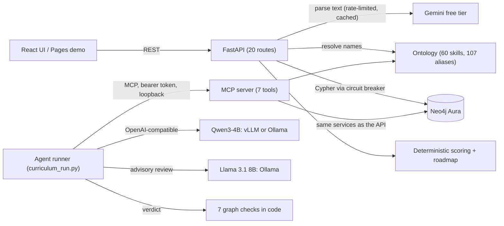

# NextNode: system design

One page on how NextNode works, how it fails, and why it is built this way. Details live in the
phase docs: [phases 1–2](TDD-phase1-2.md) (graph, scoring, free-tier resilience),
[phase 3](TDD-phase3-omnigent.md) (MCP server, agents), [phase 4](TDD-phase4-vllm.md)
(self-hosted inference). Every number below is from the code or a measured local run.

## Components and data flow

## The core split: neural reads, symbolic decides

| Layer | Does | Never does |
|---|---|---|
| LLM (Gemini, Qwen3) | Turns resumes and job descriptions into structured skills with an evidence label | Compute a score, create a skill, decide a verdict |
| Ontology guardrail | Maps every name to a canonical skill by exact name or alias; unknown names go to a review queue | Fuzzy-match (a wrong match silently corrupts scores) |
| Graph + rules | Fit score (core/preferred/nice-to-have weights, domain bonus), prerequisite chains up to 3 hops, ordered roadmap | Call an LLM |

So the same input always gives the same score (`scoring_version` "1"), and analysis keeps working
when the LLM is down: only parsing new text needs it.

## Failure modes

| Failure | Detection | Response | What the user sees |
|---|---|---|---|
| **Neo4j unavailable** (Aura Free pauses after ~3 idle days) | 3 failures within 60 s open the circuit breaker | Fail fast for 30 s with no database call, then let one probe through; success closes the breaker | 503 `GRAPH_UNAVAILABLE` with Retry-After and a "resume your instance" hint; agents get the same code as an MCP error |
| **Model rate limit** | Global limiter (8/min, 200/day, Pacific-midnight reset) checks before any network call; Gemini 429s are classified | No retry on 429; repeated text is served from a content-hash cache; explanations stop at 80% of the daily budget so parsing keeps working | 429 with Retry-After and a "free-tier budget reached" banner |
| **Malformed model output** | JSON parse + Pydantic schema validation; in the agent runner, a missing verdict or a tool call written as text | One retry with the error, then a typed error (HTTP 502) or a failed run; text-written tool calls are executed if the tool is allow-listed | An error naming the step, never a half-valid result |
| **Orchestrator stalls** (measured: a Qwen3-4B Omnigent orchestrator stalled after dispatching in 2 of 2 runs) | The run stops progressing after the parsers finish | Orchestration moved into code: a fixed parse → reason → review sequence, one revision max, tool calls capped at 25 per agent | Each step printed live; the run always ends with a verdict |

## Tradeoffs

- **Deterministic checks over LLM-as-judge.** In a measured run, the Llama 3.1 8B reviewer
  reported all 7 checks failing on a curriculum the code checks passed. Meanwhile the checks
  found real issues: the first run's draft ordered PyTorch before its prerequisite Python, and
  later first drafts had 2 and 3 issues, which one revision reduced to 0 and 1. So the
  verdict comes from the checks (fit score, coverage, order, `builds_on`, copied priority and
  reason, no URLs, hours), and the reviewer model's findings are advisory notes. Cost: the
  checks only cover what can be stated as a rule.
- **Code-driven over framework orchestration** on small models. The Omnigent bundle (orchestrator,
  3 agents, custom guardrail policies) is kept for stronger models; the runner reuses its agent
  specs, prompts and tool allow-lists, so both stay in sync.
- **Strict over fuzzy resolution.** Some real skills are missed until an alias is added (the
  review queue surfaces them), but no score is ever based on a wrong match.
- **Free tiers by design.** The limiter and cache are in-process: simple and $0, but per process
  and lost on restart. Fine for one instance; a shared store would be needed to scale out.
- **Loopback-only MCP with a per-run token** instead of a network service: safe by default, but
  agents must run on the same machine.

## Limits

| Limit | Value |
|---|---|
| Gemini calls | 8 per minute, 200 per day (configurable) |
| Prerequisite depth | 3 hops |
| Agent runner | 25 tool calls per agent, 1 revision, 6,000 characters per tool result (fits a 16k context) |
| Full agent run, laptop CPU (Qwen3-4B + Llama 3.1 on Ollama) | 1,238–1,246 s in the two complete runs with a revision |
| Neo4j breaker | Opens after 3 failures in 60 s, 30 s cooldown |

## What I did not build

- **No cloud deployment.** The vLLM Kubernetes manifests were validated on a local cluster, and
  the EKS config is written and dry-run checked but not deployed. The public demo runs entirely
  in the browser (an in-browser API and a JavaScript port of the scoring engine, tested for exact
  parity with Python).
- **No real traffic.** Single user, local runs only; no load testing.
- **No multi-tenancy or auth on the REST API.** It is meant for local use; only the MCP server
  requires a token.
- **No shared state** for the rate limiter, cache or agent runs across processes.
